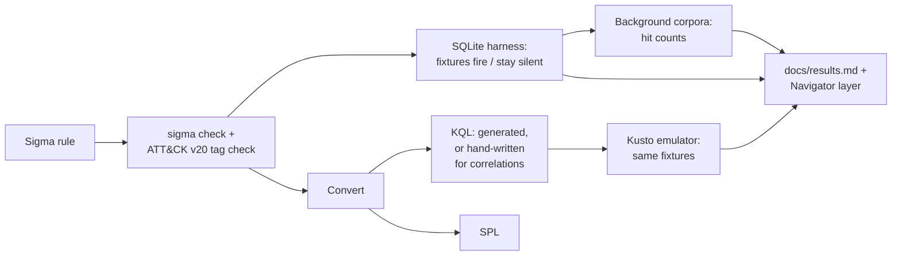

# tripline

20 Sigma detections for Linux sshd, AWS CloudTrail and Windows, tested against real and
synthetic logs in CI and converted to Microsoft Sentinel KQL and Splunk SPL. The KQL runs in
the Kusto emulator, so a query is only marked as working once it has matched the same test
logs the Sigma rule matched.

[](https://github.com/Johndenisnyagah/tripline/actions/workflows/ci.yml)


## Results at a glance

These lines are copied from [docs/results.md](docs/results.md), which CI generates from the
test runs:

<!-- results-summary:start -->
**20 rules:** 16 validated, 4 synthetic-only, 0 failing.

- Logic: 87/87 fixture tests pass in the SQLite harness (45 true-positive, 42 benign); 16 rules have at least one real (non-synthetic) true positive.
- KQL: all 20 rules executed in the Kusto emulator (14 generated, 6 hand-written queries); 87/87 fixture tests pass.
- SPL: generated for 18 rules; 2 have none (the Splunk backend cannot convert `temporal_ordered`).
<!-- results-summary:end -->

A rule counts as **validated** when every true-positive and benign test passes and at least
one true positive is a real log rather than one written for the test. The four
synthetic-only rules are listed in the results table.

[Open the coverage layer in ATT&CK Navigator](https://mitre-attack.github.io/attack-navigator/enterprise/#layerURL=https%3A%2F%2Fraw.githubusercontent.com%2FJohndenisnyagah%2Ftripline%2Fmain%2Fcoverage%2Ftripline-layer.json).
Techniques are coloured by those results, not by the tags in the rules: green for validated,
amber for synthetic-only, red for failing.

## How a rule moves through the pipeline



1. Each rule lives in `rules/` and must pass `sigma check` and a metadata test that rejects
   ATT&CK IDs revoked in v20 (T1562.008 or T1070.001, for example).
2. Each rule has an `expectations.yml` next to its fixtures in `tests/fixtures/`. True
   positives must fire and near-miss benign logs must stay silent. The fixtures are native
   logs (auth.log, CloudTrail JSON, Windows XML), parsed and loaded into SQLite, and run with
   the rule converted by `pySigma-backend-sqlite`, correlations included.
3. `python -m tripline.convert` writes `queries/kql/` and `queries/spl/`; CI fails if the
   committed queries drift from the rules.
4. The KQL then runs against the same fixtures in the Kusto emulator, in Sentinel's real table
   schemas.
5. Every rule also runs over real background logs, and the hit counts are reported and
   explained.

## The rules

| # | Rule | Technique | Source | Origin |
|---|---|---|---|---|
| 1 | [SSH password guessing](docs/rules/lnx_sshd_brute_force_password_guessing.md) | T1110.001 | sshd | original |
| 2 | [SSH login after brute force](docs/rules/lnx_sshd_brute_force_success.md) | T1110.001 | sshd | original |
| 3 | [SSH username enumeration](docs/rules/lnx_sshd_invalid_user_enumeration.md) | T1087, T1110 | sshd | original |
| 4 | [Access key after failed console login](docs/rules/aws_cloudtrail_access_key_after_failed_console_login.md) | T1098.001 | CloudTrail | original |
| 5 | [CloudTrail logging stopped or reduced](docs/rules/aws_cloudtrail_logging_disabled.md) | T1685.002 | CloudTrail | derived |
| 6 | [AdministratorAccess attached](docs/rules/aws_cloudtrail_admin_policy_attached.md) | T1098.003 | CloudTrail | original |
| 7 | [Console brute force](docs/rules/aws_cloudtrail_console_brute_force.md) | T1110 | CloudTrail | derived |
| 8 | [IAM console password created](docs/rules/aws_cloudtrail_iam_user_with_login_profile.md) | T1136.003 | CloudTrail | original |
| 9 | [Console login without MFA or as root](docs/rules/aws_cloudtrail_console_login_without_mfa.md) | T1078.004 | CloudTrail | derived |
| 10 | [S3 Block Public Access weakened](docs/rules/aws_cloudtrail_bucket_public_access_block_weakened.md) | T1686.001 | CloudTrail | derived |
| 11 | [EBS snapshot shared](docs/rules/aws_cloudtrail_ebs_snapshot_shared_externally.md) | T1537 | CloudTrail | derived |
| 12 | [Password spraying](docs/rules/win_security_password_spraying.md) | T1110.003 | Windows Security | original |
| 13 | [Local account created](docs/rules/win_security_local_account_created.md) | T1136.001 | Windows Security | derived |
| 14 | [Security log cleared](docs/rules/win_security_security_log_cleared.md) | T1685.005 | Windows Security | derived |
| 15 | [Encoded PowerShell](docs/rules/proc_creation_win_powershell_encoded_command.md) | T1059.001 | Sysmon | derived |
| 16 | [WMIC process call create](docs/rules/proc_creation_win_wmic_process_call_create.md) | T1047 | Sysmon | derived |
| 17 | [Certutil download](docs/rules/proc_creation_win_certutil_download.md) | T1105 | Sysmon | derived |
| 18 | [ClickFix paste-and-run](docs/rules/proc_creation_win_clickfix_paste_and_run.md) | T1204.004 | Sysmon | derived |
| 19 | [LSASS credential-dumping access](docs/rules/proc_access_win_lsass_suspicious_access.md) | T1003.001 | Sysmon | derived |
| 20 | [Shadow copies or backup catalog deleted](docs/rules/proc_creation_win_shadow_copy_deletion.md) | T1490 | Sysmon | derived |

*Derived* rules are tripline's own versions of a SigmaHQ rule. Each doc note says what
changed, and [NOTICE](NOTICE) credits the original authors. Every doc note covers the rule's
logic, blind spots, false positives, fixtures and corpus hits.

## What tripline adds beyond SigmaHQ

- **Correlation rules SigmaHQ doesn't have:** sshd password guessing, success after brute
  force and username enumeration (rules 1–3), and an access key created after a failed
  console login (rule 4). Windows password spraying (rule 12) is also written from scratch,
  since SigmaHQ's Windows Security rules have no 4625 spraying correlation. Rules 6 and 8 are
  original single-event rules.
- **Tests against real logs**, not only hand-written samples: soc-triage's sample scenario,
  Stratus Red Team detonation logs, the Invictus AWS dataset and Splunk attack_data. Each rule
  also has near-miss benign logs, and boundary tests such as 4 vs 5 failures.
- **KQL that has actually run.** pySigma-backend-kusto can't convert correlations, so rules
  1–4, 7 and 12 have hand-written KQL with sliding windows (`kql_manual/`), executed in the
  emulator like the generated queries.
- **Coverage credited from test results**, not tags: the Navigator layer marks a technique
  green only when its rule passes and has a real true positive.

## Relationship to soc-triage

[soc-triage](https://github.com/Johndenisnyagah/soc-triage) is a Python pipeline with its own
rule engine. Rules 1–6 are its six detections written in Sigma, and they reuse its sample
logs as fixtures. soc-triage does not consume these rules.

A CI job runs soc-triage's own detection on those sample logs and compares what fires with
tripline's rules ([tests/parity_map.yml](tests/parity_map.yml)). Any difference must be listed
there with a reason, or the job fails. Two differences are deliberate and documented:
- Rule 6 matches only the AdministratorAccess policy, while soc-triage also counts
  IAMFullAccess and PowerUserAccess.
- Rule 2 measures its 10 minutes from the fifth failure, the way the Sigma correlation is
  evaluated. soc-triage requires all five failures in the 10 minutes before the login.

soc-triage also merges findings from different sources into one incident when they share an
entity (the same IP in sshd and CloudTrail, say), and rates the incident by how many ATT&CK
tactics it spans. Sigma correlations can relate events from several rules, but their output
is an alert, not a merged incident with a computed severity, so that stage stays in
soc-triage.

## What is measured and what is not

- **Synthetic and real tests are labelled.** Every fixture records its origin in
  `expectations.yml`. Rules 10, 16, 17 and 19 have synthetic true positives only, because no
  small, licence-compatible real capture could be found.
- **soc-triage's sample logs count as real**, although they are a hand-written scenario.
- **Corpus hits are not a false-positive rate.** Every rule runs over a real background log:
  - Loghub OpenSSH;
  - flaws.cloud CloudTrail;
  - Nextron evtx-baseline (Security and Sysmon).

  Two of these contain attack traffic and none is labelled. Hits are counted and explained in
  each doc note (rule 19, for example, flags the SNMP service on the benign baseline). A zero
  can mean the log simply has no such events.
- **No production telemetry.** Nothing here has run in a live Sentinel or Splunk. SPL is
  generated but never executed (there's no Splunk in CI), and the process rules assume
  Microsoft's `Sysmon` KQL parser function is deployed in the workspace.

## Conversion notes

[docs/conversion-notes.md](docs/conversion-notes.md) records every conversion problem. Three
examples:
- In Sentinel's `AWSCloudTrail`, `RequestParameters` is a string, not dynamic, so nested
  fields become `tostring(parse_json(...))`.
- Splunk's generated correlations use fixed time buckets where Sigma slides its window.
- Splunk's `_raw` includes the syslog prefix, so sshd rules use `contains` rather than
  `startswith`.

KQL for the six correlation rules is hand-written, because the Kusto backend refuses
correlations. Each query is tested against the same fixtures as its Sigma rule.

## Run it locally

Requires Python 3.12.

```bash
python -m venv .venv
.venv/bin/pip install -e ".[dev]"   # Windows: .venv\Scripts\pip
pytest                              # metadata, logic, conversion and report tests
python -m tripline.convert          # regenerate queries/
python -m tripline.corpora          # run every rule over the background corpora (downloads ~280 MB)
```

The KQL tests need the Kusto emulator (`docker run -e ACCEPT_EULA=Y -p 8080:8080
mcr.microsoft.com/azuredataexplorer/kustainer-linux:<tag in ci.yml>`, then `pytest -m kql`).

## Licences and data sources

- Code: MIT ([LICENSE](LICENSE)).
- Detection rules in `rules/`: Detection Rule License 1.1 ([rules/LICENSE](rules/LICENSE)).
- Copied logs (soc-triage, Stratus Red Team, Invictus, Splunk attack_data), derived SigmaHQ
  rules and the download-only corpora are all listed with source, version and licence in
  [NOTICE](NOTICE).

## How this was built

Built with Claude Code as a pair programmer. I chose the scope, rules and thresholds and
reviewed each rule and test; the decisions are recorded in [CLAUDE.md](CLAUDE.md).
